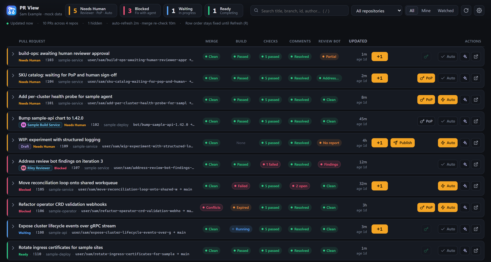
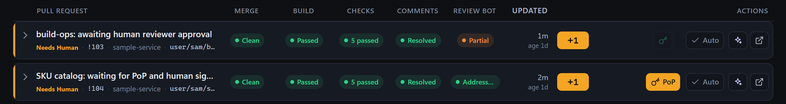
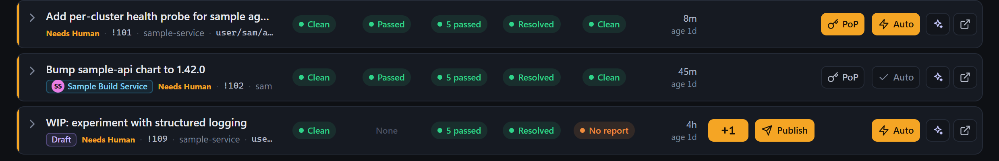
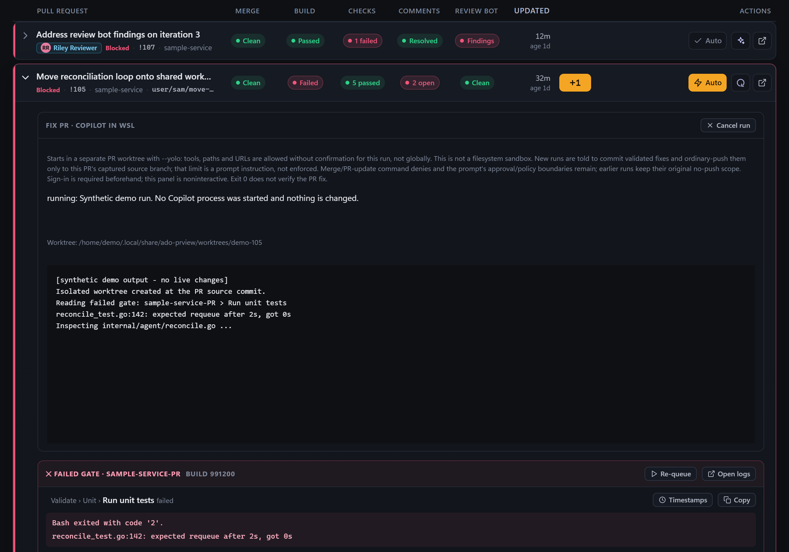
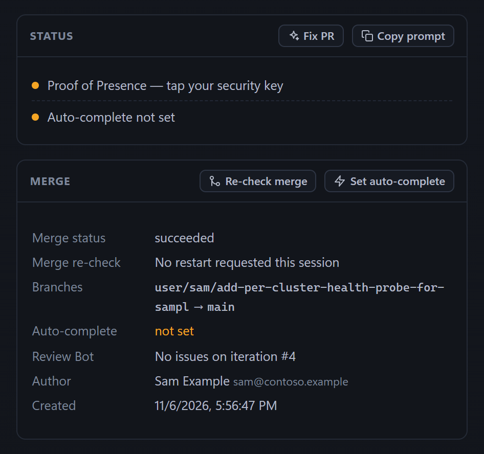

# ADO PR View

In the Azure DevOps portal, especially with a lot of pull requests, it is hard
to tell at a glance which PRs have finished all their machine validation and now
only need a person to review, approve or finish them. ADO PR View is a small
Windows app that shows your PRs, and those of people you choose to watch, in one
table sorted by what they are waiting on: **Needs Human**, **Blocked**,
**Waiting** or **Ready**.

## Get it

- **Download:** the [latest release](../../releases/latest) has a per-user
  installer (`AdoPrView-v<version>-win-x64-setup.exe`, no administrator rights),
  a portable ZIP of the same app, and SHA-256 checksums. It needs Windows 10/11
  x64 and the Microsoft Edge WebView2 Evergreen Runtime; .NET is included. The
  files are not code-signed, so SmartScreen may warn. Close any running
  dashboard before installing, upgrading or uninstalling; setup refuses to run
  while one is open and never touches your settings and data in
  `%LOCALAPPDATA%\AdoPrView`.
- **Set it up with an agent:** give [INSTALL.md](INSTALL.md) to a CLI coding
  agent. It has a copyable kickoff prompt. The agent finds your existing Azure
  sign-in, repositories and settings, checks your ADO identity with read-only
  requests, merges configuration safely and launches the dashboard.

## What it shows you

### Needs Human: a reviewer still has to approve

Everything automated is done and the PR is waiting for reviewer approval. The
**+1** button is enlarged on these rows. Any approver can give it, so watched
PRs show it too; it is amber only on your own PRs.

### Needs Human: only your finishing steps remain

Reviews are in, and only finishing steps remain: **PoP** (Proof of Presence with
a security key), **Auto** (set auto-complete) or **Publish** (a draft). They can
appear in any combination. They are amber on your PRs; a watched PR shows the
same steps without amber.

Needs Human is the app's verified, human-only state for what it read from ADO;
it is not a guarantee that every policy is known or green.

### Inline Copilot Fix

The sparkle button on a row starts Copilot CLI in WSL to fix that PR in its own
isolated worktree. Its output streams into the PR's expanded row, where you can
follow or cancel it. The output in this picture is synthetic demo data. Fix is
optional and needs WSL with an authenticated Copilot CLI; it runs with broad
permissions and the worktree is not a sandbox. Read
[Inline Copilot Fix](docs/usage.md#inline-copilot-fix) before using it.

### Merge re-checks and auto-complete

- **Merge re-checks:** ADO's merge preview goes stale when the target branch
  moves. The app periodically asks ADO to recompute it, and **Re-check merge**
  does it on demand. It never merges or pushes.
- **Auto** asks Azure DevOps to complete the PR when its policies allow; it does
  not approve the PR or bypass checks. Once set, it turns into a grey check
  that you can click to cancel.
- **Failed builds:** expand a blocked row to see the failed tasks, their errors
  and the end of the log, with **Re-queue** and **Open logs**.

## What you still do after an agent sets it up

The agent does the configuration. You may still need to:

- complete any sign-in, MFA, SSO or consent prompt it cannot do for you;
- answer a question about which repositories, watched authors or WSL checkout
  to use, only if it cannot work that out;
- sign in to Copilot CLI in WSL, only if you want inline Copilot Fix;
- do the actual reviewing, approving, Proof of Presence and other PR decisions.
  The app shows you what is left; it does not do these for you.

Viewing PRs needs neither WSL nor Copilot.

## Documentation

- [INSTALL.md](INSTALL.md): agent-first installation and update guide.
- [docs/usage.md](docs/usage.md): lanes, row actions, keys, diagnostics,
  merge re-checks, Proof of Presence, auto-complete, Copilot Fix and recovery.
- [docs/DESIGN.md](docs/DESIGN.md): architecture, classification rules and the
  ADO calls used.
- [docs/development.md](docs/development.md): building, offline tests and
  releases.

## License

[MIT](LICENSE)
